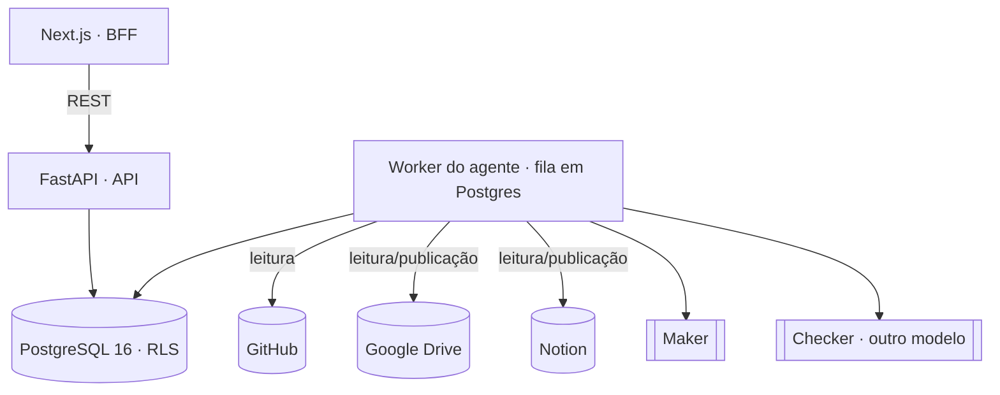

# Basho

Plataforma de IA que **executa e organiza a operação de projetos de P&D tecnológico** e, no mesmo fluxo, **constrói continuamente as evidências exigidas pela Lei do Bem** (Lei nº 11.196/2005) — para PMEs que usufruem ou pretendem usufruir dos incentivos, observados os requisitos legais.

> O Basho apoia a documentação e a identificação preliminar de atividades **potencialmente qualificáveis, sujeitas a análise**. Não garante benefício fiscal, não decide enquadramento, não submete o FORMP&D e não substitui responsáveis técnicos, contábeis ou legais.

## O problema

Empresas que fazem P&D costumam reconstruir a documentação da Lei do Bem no fim do ano, a partir de memória, planilhas e commits soltos. O resultado é caro, frágil e difícil de defender numa fiscalização. O Basho inverte isso: **a evidência é registrada enquanto o trabalho acontece**, com origem, versão e hash, e os relatórios são montados a partir dela.

## Como funciona

1. **Leitura das fontes da organização** — GitHub (commits, PRs), Notion (páginas e databases) e Google Drive (documentos) são conectados uma vez pela organização. O `worker` sincroniza o conteúdo **só para leitura** e grava cada item no **Evidence Ledger**.
2. **Maker escreve** — um modelo de linguagem prepara o relatório do período; **cada afirmação cita a evidência** que a sustenta.
3. **Checker confere** — um verificador de **outro modelo**, que não vê o raciocínio do Maker, confere as citações. Junto com checks determinísticos, decide se o artefato está `verified` ou `needs_human`.
4. **Pessoas revisam e decidem** — o que falta ou diverge vira **pendência** para o responsável (pesquisador, gerente ou fiscal). Horas, valores, alocações e participantes **nunca são inferidos**: só entram por registro formal confirmado por uma pessoa.
5. **Publicação** — relatórios verificados podem ser publicados numa pasta **BASHO** no Drive ou numa página do Notion autorizadas pelo gerente.
6. **Correção propaga** — corrigir um dado gera um novo evento (`supersedes`) e reabre tudo que dependia dele.

## Funções na plataforma

| Função | O que faz |
| --- | --- |
| **Pesquisador** | Lê o relatório do período pronto, corrige, responde pendências e aprova a versão exata. Não precisa conectar fontes: elas vêm da organização. |
| **Gerente de projetos** | Acompanha consolidação e pendências, vê o dossiê, autoriza links de publicação, gera e publica relatórios, consulta as integrações. |
| **Fiscal** | Examina pacote, despesas e sinalizações com critério e fonte, registra a decisão e devolve pendências. |

## Princípios (inegociáveis)

- **O sistema executa, o humano supervisiona** — atos formais/fiscais exigem aprovação humana; o agente nunca recebe tools de nível `formal` ([ADR-0005](docs/adr/0005-gates-de-permissao-e-aprovacao-humana.md)).
- **Nada é inventado** — dados formais só vêm de registros confirmados por humanos.
- **Tudo é rastreável** — ledger append-only, sem `UPDATE`/`DELETE` ([ADR-0003](docs/adr/0003-evidence-ledger-append-only.md)).
- **Quem gera não valida** — Maker–Checker com modelos diferentes ([ADR-0004](docs/adr/0004-maker-checker-multi-modelo.md), [ADR-0013](docs/adr/0013-maker-checker-no-featherless.md)).
- **Segurança** — `tenant_id` + RLS em toda tabela de negócio, roles de banco de menor privilégio, conteúdo externo tratado **como dado, nunca como instrução**, segredos só em variáveis de ambiente, LGPD sem PII em logs ([ADR-0006](docs/adr/0006-seguranca-rls-lgpd-prompt-injection.md)).

## Arquitetura



- **Monólito modular** ([ADR-0001](docs/adr/0001-monolito-modular.md)): módulos em `backend/src/basho/<módulo>/` (`projects`, `evidence`, `agent`, `connectors`, `publishing`, `audit`…) falam só pelo `service` público.
- **web** não contém regra de negócio; o BFF do Next guarda identidade e segredo no servidor.
- **api** valida a borda, autoriza e lê projeções; **worker** roda os jobs do agente, a sincronização das fontes e a publicação.

Detalhes: [`docs/architecture.md`](docs/architecture.md) · contratos: [`docs/contracts.md`](docs/contracts.md).

## Stack

| Pasta | Stack |
|-------|-------|
| `backend/` | Python 3.12 · uv · FastAPI · Pydantic v2 · SQLAlchemy 2 + Alembic · structlog · pytest · ruff · mypy |
| `frontend/` | Next.js (App Router) · TypeScript strict · Tailwind · shadcn/ui · TanStack Query · Zod · Vitest |
| `docker-compose.yml` | PostgreSQL 16 para desenvolvimento local |
| `scripts/` | `demo-up.ps1` (sobe a demonstração completa no Windows) e utilitários |
| `docs/` | arquitetura, ADRs, contratos, demo, deploy e práticas de engenharia |

LLMs: Maker e Checker configuráveis por variável (`MAKER_PROVIDER`, `MAKER_MODEL`, `CHECKER_MODEL`), sempre com modelos diferentes.

## Ambientes

| Ambiente | Onde | Dados | Acesso |
| --- | --- | --- | --- |
| Demo navegável | Vercel (`basho-demo`), modo `mock` | sintéticos, no navegador | aberto |
| App com backend real | Railway (`web`, `api`, `worker`, `migrate`, Postgres), modo `api` | sintéticos (`is_synthetic`) + leitura real de Notion/Drive/GitHub | Basic Auth + login por função |
| Local | `scripts/demo-up.ps1` ou setup manual abaixo | sintéticos | login por função |

Todos os dados de demonstração são fictícios e marcados `is_synthetic`. Deploy e variáveis: [`docs/deploy.md`](docs/deploy.md). Roteiro da apresentação: [`docs/demo.md`](docs/demo.md).

## Pré-requisitos

- [uv](https://docs.astral.sh/uv/) (instala o Python 3.12 automaticamente)
- Node.js (versão em `frontend/.nvmrc`) e npm
- Docker com Docker Compose

## Setup local

**Atalho (Windows):** `powershell -ExecutionPolicy Bypass -File scripts/demo-up.ps1` sobe Postgres, migrações, seed, API, worker e front. Veja [`docs/demo.md`](docs/demo.md).

1. **Variáveis de ambiente**

   ```bash
   cp .env.example .env
   ```

   Preencha todos os valores do `.env` (nunca versione esse arquivo). A API **não inicia**
   se alguma variável obrigatória faltar; a mensagem de erro lista só os nomes das variáveis,
   nunca os valores.

2. **Banco de dados**

   ```bash
   docker compose up -d --wait   # sobe o Postgres 16 e espera o healthcheck
   docker compose ps             # STATUS deve mostrar "healthy"
   ```

   São dois roles (ADR-0006): `MIGRATION_DATABASE_URL` usa o usuário do compose, dono do
   schema (ex.: `postgresql+psycopg://basho:<senha>@localhost:5432/basho`); `DATABASE_URL`
   usa um login da aplicação, membro de `basho_api`, sem UPDATE/DELETE no ledger e sujeito
   à RLS. Aplique as migrações e crie esse login uma vez (passo a passo em
   [`backend/README.md`](backend/README.md#roles-do-banco-e-rls)).

3. **Backend**

   ```bash
   cd backend
   cp ../.env .env               # ou exporte as variáveis no shell
   uv sync
   uv run uvicorn basho.main:app --factory --reload   # http://localhost:8000/health
   ```

4. **Frontend**

   ```bash
   cd frontend
   npm ci
   npm run dev                   # http://localhost:3000 (modo mock, sem backend)
   npm run gen:api               # regenera os tipos a partir de http://localhost:8000/openapi.json
   ```

   Para usar o backend real, defina `NEXT_PUBLIC_DATA_SOURCE=api` e `NEXT_PUBLIC_BASHO_PROJECT_ID`.

## Checks (os mesmos da CI)

```bash
cd backend  && uv run ruff check . && uv run ruff format --check . && uv run mypy && uv run pytest
cd frontend && npm run lint && npm run typecheck && npm test && npm run build
```

A CI (`.github/workflows/ci.yml`) roda esses checks em todo PR para `main`. Testes de banco
rodam quando `TEST_DATABASE_URL` está definida; chamadas reais a LLM só com `RUN_LLM_TESTS=1`.

## Documentação

- [Arquitetura](docs/architecture.md) e [proposta-alvo](docs/arquitetura.md)
- [Decisões de arquitetura (ADRs)](docs/adr/) — a ADR aceita mais recente prevalece
- [Contratos](docs/contracts.md) · [Demo](docs/demo.md) · [Deploy](docs/deploy.md)
- [Práticas de engenharia](docs/engineering-practices.md)
- [Regras para agentes de IA](CLAUDE.md) · [subagentes de desenvolvimento](.claude/agents/README.md)

## Contribuindo

Siga `CLAUDE.md` e `docs/engineering-practices.md`: uma issue → uma branch → um PR,
Conventional Commits e o template de PR em `.github/pull_request_template.md`.
Mudança estrutural exige uma nova ADR (`docs/adr/0000-template.md`) no mesmo PR.
