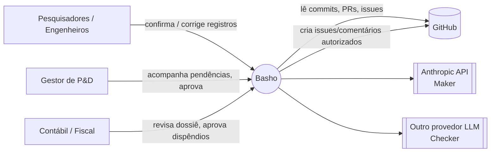
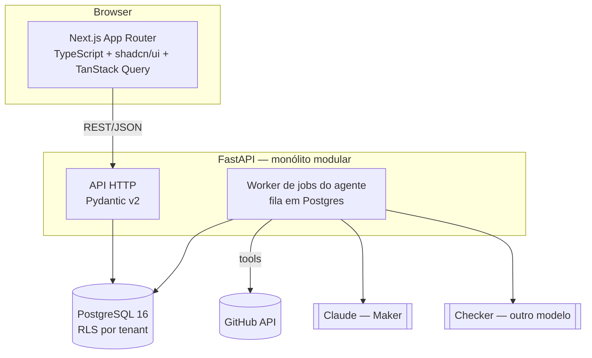
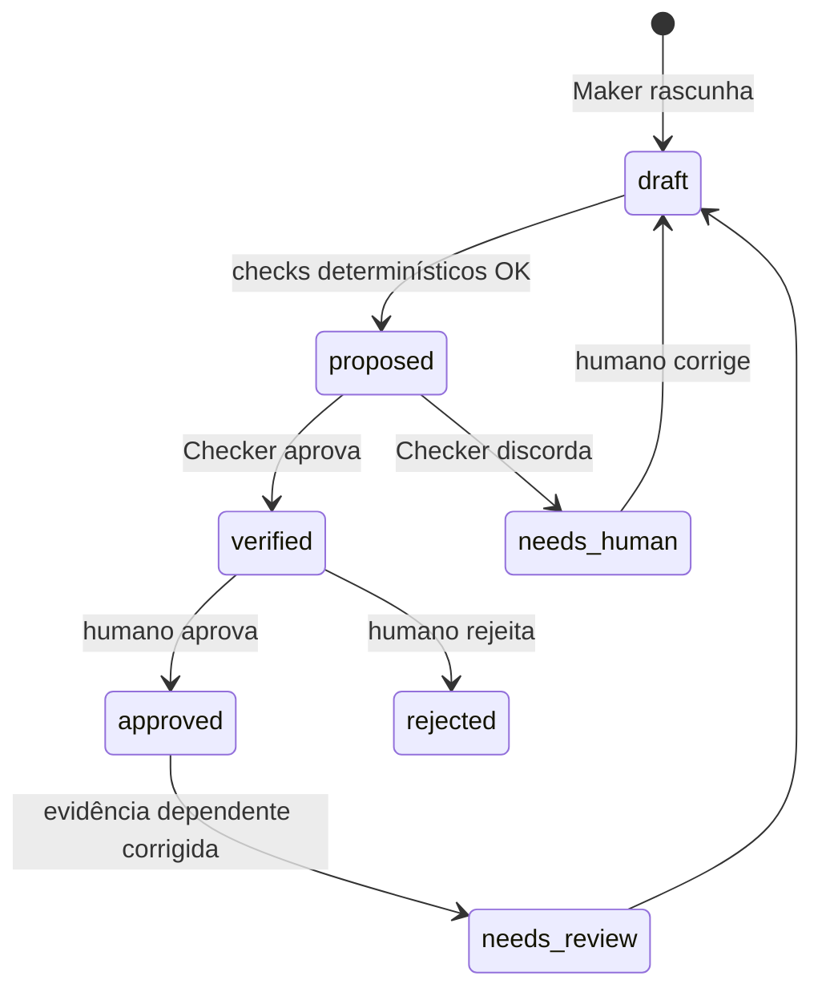
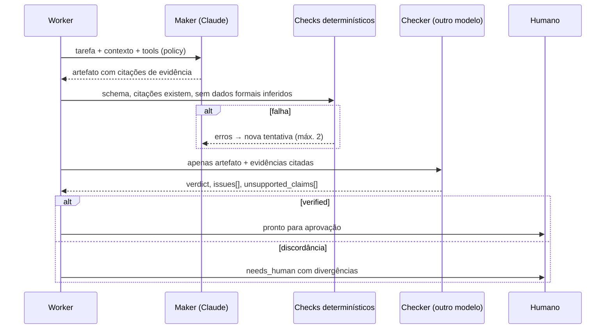

# Arquitetura do Basho

> **Proposta em revisão:** a [ADR-0008](adr/0008-autonomia-documental-lei-do-bem.md) propõe uma arquitetura-alvo alinhada ao Manual regulatório de autonomia (Lei do Bem), descrita em [arquitetura.md](arquitetura.md). Até a aceitação, **este documento e as ADRs aceitas prevalecem**.

> Documento vivo. Toda mudança estrutural exige uma ADR em [`docs/adr/`](adr/). Em caso de conflito, **a ADR mais recente aceita prevalece** sobre este texto, e este texto deve ser atualizado.

## 1. Visão

Basho é uma plataforma de IA que **executa e organiza o trabalho operacional de projetos de P&D tecnológico** e, no mesmo fluxo, **constrói continuamente as evidências exigidas pela Lei do Bem** (Lei nº 11.196/2005). Público: PMEs que realizam P&D e usufruem ou pretendem usufruir dos incentivos, observados os requisitos legais.

Princípios inegociáveis:

1. **O sistema executa, o humano supervisiona.** Tarefas operacionais são automatizadas; atos formais/fiscais exigem aprovação humana ([ADR-0005](adr/0005-gates-de-permissao-e-aprovacao-humana.md)).
2. **Nada é inventado.** Horas, valores, alocações, participantes e elegibilidade nunca são inferidos — só vêm de registros formais confirmados por responsáveis.
3. **Tudo é rastreável.** Toda afirmação em um artefato aponta para uma evidência com proveniência ([ADR-0003](adr/0003-evidence-ledger-append-only.md)).
4. **Quem gera não valida.** Artefatos formais passam por um verificador independente, de outro modelo ([ADR-0004](adr/0004-maker-checker-multi-modelo.md)).
5. **Correção propaga.** Corrigir um dado reabre tudo que dependia dele.
6. **O sistema não garante benefício fiscal** nem substitui responsáveis técnicos, contábeis ou legais.

## 2. Contexto (C4 nível 1)



## 3. Containers (C4 nível 2)



- **web**: UI de pendências, correção/aprovação, dossiê. Não contém regra de negócio.
- **api**: endpoints REST, validação de borda, autorização, leitura de projeções.
- **worker**: executa jobs do agente (investigação, rascunho, verificação). Mesmo código do backend, processo separado.
- **db**: única fonte de verdade. Ledger append-only + tabelas de projeção.

## 4. Módulos do backend (C4 nível 3)

Monólito modular ([ADR-0001](adr/0001-monolito-modular.md)). Cada módulo é um pacote em `backend/src/basho/<modulo>/` com `domain/` (entidades, regras puras), `service.py` (casos de uso), `repository.py` (acesso a dados), `api.py` (rotas). **Módulos só se comunicam via `service` público**, nunca importando o repositório de outro módulo.

| Módulo | Responsabilidade |
| --- | --- |
| `projects` | Projetos, marcos, desafios tecnológicos, hipóteses |
| `activities` | Atividades/experimentos de P&D e registros de atividade |
| `evidence` | Evidence Ledger: eventos, proveniência, vínculos, hash |
| `people` | Participantes e papéis (dados pessoais minimizados — LGPD) |
| `expenses` | Dispêndios **informados por sistemas/responsáveis**, vinculados a atividades |
| `compliance` | Checagens de completude, lacunas, dossiê, preparação (não decisão) de enquadramento |
| `agent` | Orquestração Maker–Checker, tools, policy de permissões, jobs |
| `connectors` | Adaptadores de fontes externas (GitHub no MVP) |
| `audit` | Log de auditoria imutável de toda ação de agente e humano |

## 5. Evidence Ledger e estados



- `evidence_events` é **append-only** (sem UPDATE/DELETE; reforçado por permissão de banco). Cada evento: `id`, `tenant_id`, `kind`, `source` (github, user, system…), `source_ref` (sha, PR#, doc id), `actor` (usuário ou agente+modelo), `payload` (JSONB), `content_hash` (SHA-256), `created_at`, `supersedes` (opcional).
- Vínculos: `Projeto → Atividade → Evidência ↔ Pessoa ↔ Dispêndio` (tabelas de link com `evidence_event_id`).
- **Correção = novo evento** que `supersedes` o anterior. Um job recalcula dependências e move artefatos afetados para `needs_review`.

## 6. Agente: Maker–Checker



Detalhes em [ADR-0004](adr/0004-maker-checker-multi-modelo.md). Permissões de tools em [ADR-0005](adr/0005-gates-de-permissao-e-aprovacao-humana.md).

> **Proposta em análise:** a [ADR-0009](adr/0009-agente-perfis-de-tarefa-e-orquestrador.md) organiza o Maker em perfis de tarefa (`research_report`, `coordination`, `technical_fiscal`, `investigation`) coordenados por um orquestrador determinístico no worker, incorporando o [handoff ResearchOps](handoff/README.md). Até o aceite, este diagrama segue normativo.

## 7. Segurança

Resumo de [ADR-0006](adr/0006-seguranca-rls-lgpd-prompt-injection.md): RLS por `tenant_id`, menor privilégio no banco, LGPD (minimização e separação de dados pessoais), conteúdo externo tratado como **dado, nunca instrução**, audit log imutável, segredos só por variável de ambiente, validação em todas as bordas.

## 8. Desempenho e custo

- Prompt caching nas instruções fixas e definições de tools.
- Roteamento de modelos: modelos menores para triagem/classificação; modelo maior só para redação formal.
- Checker só em artefatos formais.
- Jobs assíncronos em fila Postgres (`SELECT … FOR UPDATE SKIP LOCKED`); sem Redis/Temporal até haver necessidade medida.
- Consultas paginadas e indexadas por `(tenant_id, project_id, created_at)`.

## 9. Estrutura do repositório (alvo)

```
backend/            FastAPI (uv, ruff, mypy, pytest)
  src/basho/<modulo>/
  migrations/       Alembic
  tests/
frontend/           Next.js (App Router, TS strict)
docs/
  architecture.md
  engineering-practices.md
  adr/
docker-compose.yml  Postgres local
.env.example
```

## 9.1 Publicação em Drive e Notion (ADR-0010, proposta)

O usuário cola um link com permissão de edição (pasta do Drive, página do Notion, repositório do GitHub) e o Basho passa a gerar e publicar os relatórios numa pasta `BASHO`, **sem aprovação de rotina**.

```
link colado ──► parse_link (só extrai o ID) ──► verificação de acesso ──► project_links (autorização do tenant)
                                                                                  │
Maker ─► Checker ─► artefato verified ──► enqueue ──► publications (fila) ──► worker ──► Drive: <pasta>/BASHO/<relatório>
                                                                                      └──► Notion: <página>/BASHO/<relatório>
```

- A publicação é um **passo determinístico do worker depois do Checker**, não uma tool do agente: o agente continua sem tool `formal` nem de escrita externa ([ADR-0005](adr/0005-gates-de-permissao-e-aprovacao-humana.md)).
- Só se publica em link **ativo** cadastrado por um gerente; credenciais do Basho (service account do Google, token do Notion) ficam em variáveis de ambiente ([ADR-0006](adr/0006-seguranca-rls-lgpd-prompt-injection.md)). O usuário precisa compartilhar a pasta/página com a conta do Basho: um link "qualquer um edita" não autentica chamadas de API.
- Idempotente: unicidade (tenant, link, artefato, tipo) e busca por nome no destino antes de criar. Falha transitória volta à fila com backoff.
- Aprovação formal (`approved`/`rejected`) segue existindo e continua só do gerente; deixa de ser pré-requisito para publicar documento. O que falta ou diverge vira pendência e aparece no documento.

## 10. Recorte do MVP

Ver [ADR-0007](adr/0007-recorte-mvp-hackathon.md).


> **Demonstração local, proposta:** a [ADR-0011](adr/0011-login-local-demonstracao-por-funcao.md) documenta o login solicitado com contas sintéticas, sessões revogáveis e acesso por função no Next. Não substitui a autenticação de produção nem altera as decisões aceitas de isolamento, ledger e aprovação humana.
