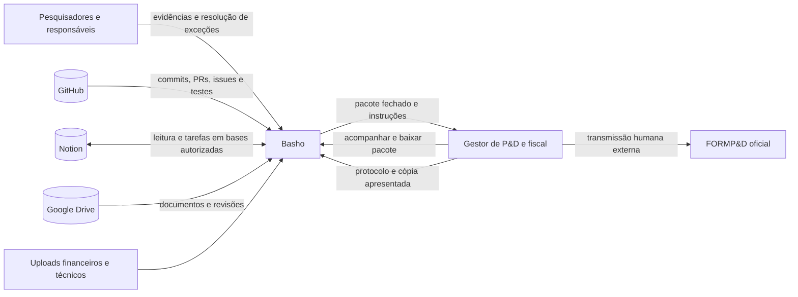
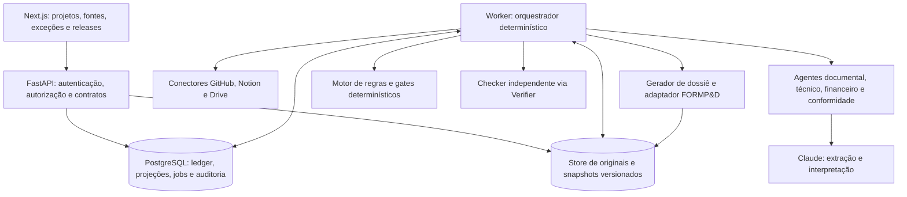
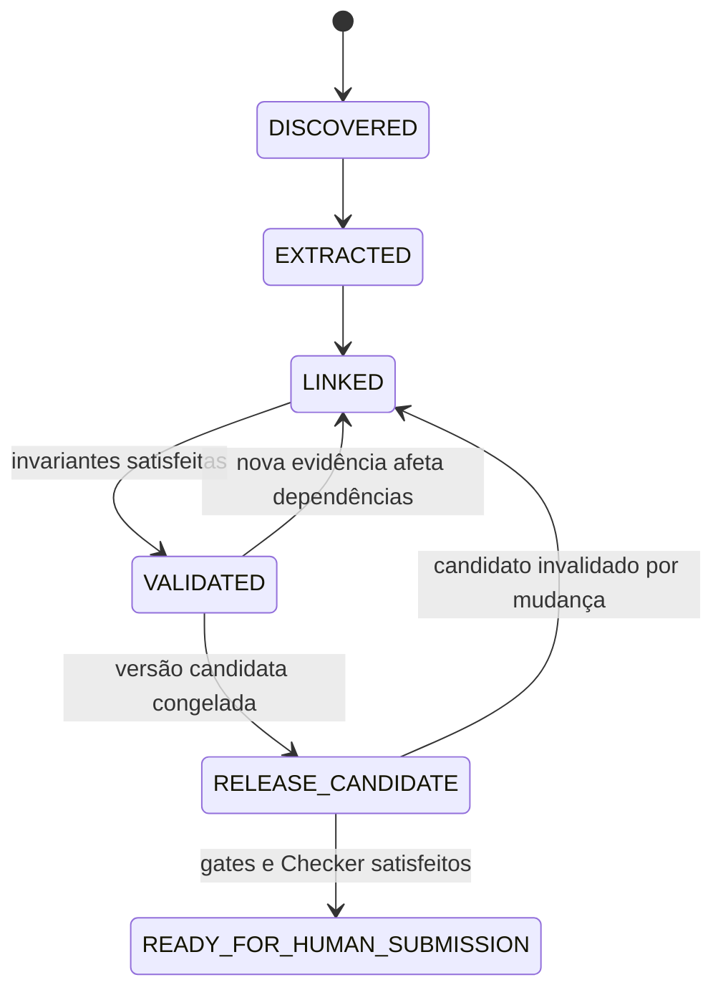

# Arquitetura do Basho — autonomia documental de P&D

> Arquitetura alvo, revisão de 07/11/2026, baseada no **Manual regulatório de autonomia — Lei do Bem**, v1.0, novembro/2026 (15 páginas). Este documento especifica comportamento a construir; não atesta implementação nem validação regulatória. A [ADR-0008](adr/0008-autonomia-documental-lei-do-bem.md) registra as mudanças propostas sobre as ADRs aceitas. Até sua aceitação pela equipe, as ADRs anteriores continuam regendo a implementação existente.

## 1. Visão, escopo e leitura dos requisitos

O Basho coleta evidências de GitHub, Notion, Google Drive e uploads, organiza projetos por empresa e ano-base, reconcilia registros e produz um pacote de preparação para o FORMP&D. Executa coleta, investigação, atualização e geração documental autonomamente; solicita intervenção apenas em exceções materiais. A equipe humana transmite no sistema oficial e registra o protocolo.

As marcações seguem o manual: **[LEGAL]** identifica requisito assim classificado pelo documento de referência, sujeito à conferência normativa; **[OPERACIONAL]** identifica controle de produto; **[MVP]** identifica entrega da demonstração. Este texto adapta a especificação fornecida, sem certificar a vigência das referências ou dos layouts oficiais.

- **[LEGAL]** Requisitos de fruição, controles contábeis, prestação eletrônica e responsabilidade da empresa devem ser verificados para o ano-base (manual, §1).
- **[OPERACIONAL]** O Basho propõe classificação e valores fundamentados; não garante benefício fiscal nem declara aprovação governamental.
- **[OPERACIONAL]** PDF e dossiê são apoio. Nunca substituem o envio eletrônico nem são apresentados como formulário oficial.
- **[OPERACIONAL]** Calendário regulatório, política de retenção e adaptadores de exportação são versionados. Prazo e layout não ficam fixos no código.

### 1.1. Princípios

1. Autonomia por padrão, com bloqueio proporcional ao item e à materialidade.
2. Originais imutáveis; interpretações e relatórios são derivados versionados.
3. Toda afirmação sustentada e todo valor incluído possuem origem citável e verificável.
4. Agentes interpretam; código verifica estados, permissões, somas, vínculos e liberação.
5. Horas, participantes, valores e rateios vêm de registros confiáveis; commits não geram horas.
6. Correções invalidam dependências, preservando snapshots fechados e enviados.
7. Atos oficiais e decisões fiscais materiais permanecem humanos.

## 2. Contexto — C4 nível 1



Prioridade de fontes: escrituração e documentação fiscal para fatos financeiros; testes e artefatos reproduzíveis para fatos técnicos; apontamentos validados para horas. Divergências são registradas, nunca resolvidas pela preferência de um LLM por um texto (manual, §2).

## 3. Containers — C4 nível 2

Preservar o monólito modular, Python/FastAPI, PostgreSQL e Next.js das ADRs [0001](adr/0001-monolito-modular.md) e [0002](adr/0002-stack-python-fastapi-nextjs.md). Não é necessário trocar o framework para aplicar o manual.



- API e worker são processos do mesmo backend. Regras de domínio não ficam no frontend.
- PostgreSQL concentra metadados, eventos append-only, projeções e fila persistente; os bytes ficam no store versionado. Demo pode usar diretório local indexado.
- Fila Postgres com aquisição exclusiva de jobs, tentativas limitadas e backoff. Redis ou outro coordenador exigem necessidade demonstrada e ADR.
- O orquestrador controla estados e agenda tarefas tipadas; não delega os critérios de liberação a conversas entre agentes.
- Checker independente é mantido para artefatos formais; gates determinísticos continuam obrigatórios e não podem ser substituídos pelo parecer do modelo.

## 4. Módulos e responsabilidades dos agentes

Cada módulo mantém `domain/`, `service.py`, `repository.py` e `api.py` quando aplicáveis. Comunicação entre módulos ocorre pelo serviço público. As divisões abaixo são arquitetura alvo, não arquivos já implementados nesta branch.

| Módulo | Responsabilidade |
| --- | --- |
| `projects` / `activities` | Empresa/ano-base, projetos, hipóteses, atividades, experimentos e resultados |
| `evidence` | Ledger, versões, originais, citações e grafo de dependências |
| `people` | Pessoas, papéis e apontamentos confiáveis, com dados minimizados |
| `expenses` | Documentos, lançamentos, conciliação e critérios demonstrados de alocação |
| `compliance` | Regras, calendário, exceções, gates, releases e exportação |
| `agent` | Orquestrador, agentes especializados, Verifier, prompts, tools e jobs |
| `connectors` | Adaptadores GitHub, Notion, Drive e uploads |
| `audit` | Registro imutável das ações e decisões humanas/automáticas |

| Executor | Ações autônomas | Limites |
| --- | --- | --- |
| Documental | Sincronizar, extrair, relacionar versões e gerar fichas | Não sobrescrever originais nem fabricar histórico |
| Técnico de P&D | Identificar testes, barreiras, resultados e narrativas citadas | Não transformar bug comum em barreira tecnológica nem decidir elegibilidade definitiva |
| Financeiro | Reconciliar linhas, verificar totais, duplicidades e recomputar propostas | Não criar horas, comprovantes ou rateios; não alterar escrituração |
| Conformidade | Avaliar completude, executar regras e administrar exceções com prova | Não encerrar bloqueador material sem evidência |
| Orquestrador | Coordenar dependências, retries, Checker e pacote | Não transmitir ao FORMP&D ou praticar ato tributário |

Cada agente tem contexto separado, saída estruturada e allowlist de ferramentas. Não há comunicação livre entre agentes. Esta especialização depende da ADR-0008, pois altera a ADR-0004.

## 5. Ledger, dados e contratos

### 5.1. Evidências e proveniência

Preservar `evidence_events` append-only da [ADR-0003](adr/0003-evidence-ledger-append-only.md): `id`, `tenant_id`, `kind`, `source`, `source_ref`, `actor`, `payload`, `content_hash`, `created_at`, `supersedes` e `is_synthetic`. Bloquear UPDATE/DELETE no banco. Correção gera novo evento e nova projeção.

Usar `tenant_id` como identificador canônico da organização; o `organization_id` do manual é mapeado na borda para esse campo, validando a associação ao usuário autenticado. Todo registro de negócio e acesso a arquivo respeita o tenant. `year` representa o ano-base.

Cada versão registra fonte, ID externo, revisão/SHA, SHA-256 quando aplicável, URI, título, captura, autor, ACL, status de validação e localizador granular (página, trecho, linha, célula ou commit). Hash e ID de origem não substituem a autorização de acesso.

| Entidade | Campos e relações essenciais |
| --- | --- |
| Organization / TaxYear | Tenant, CNPJ, ano-base, regime informado, confirmação fiscal, políticas versionadas |
| Project / Activity | Objetivo, estado da técnica, novidade, barreira, método, período e responsável |
| Evidence / Version | Proveniência, objeto original e versões imutáveis |
| Claim / EvidenceLink | Afirmação, versão da evidência, localizador, projeto/atividade, justificativa e status |
| Experiment / Result | Hipótese, ambiente, parâmetros, dataset, execução, métricas e conclusão |
| Expense / Allocation | Documento, lançamento, fornecedor, competência, valor, parcela proposta e critério documentado |
| Person / TimeEntry | Pessoa, período, atividade, horas/custo, registro de origem e validação |
| Exception / Task | Classe A0–A4, objeto, motivo, prova requerida, responsável, status e prazo interno |
| Report / Release | Tipo, versão, ano-base, hashes, fontes congeladas, versão de regras/layout e artefatos |
| AuditEvent | Ator, ação, instante, hashes anterior/novo, justificativa e correlation_id |

Relações são muitos-para-muitos. O grafo liga afirmação → versão → trecho e também despesas, pessoas e atividades. Evidência pode apoiar vários projetos, mas a mesma parcela financeira não pode ser contada duas vezes.

### 5.2. Execução tipada

Entrada mínima: `tenant_id`, `year`, `project_ids`, `authorized_source_ids`, `correlation_id`. Saída mínima: `execution_id`, `evidence_ids`, `claims`, `pending_items`, `versions`, `actions`, `agent_version`, `schema_version` e erros localizados. Texto narrativo é derivado dessa saída validada por schema.

Exemplo de afirmação interna, sem pretensão de layout oficial:

```json
{
  "tenant_id": "11111111-1111-4111-8111-111111111111",
  "project_id": "PD-001",
  "year": 2026,
  "claim": "Método experimental executado",
  "evidence_ids": ["github:pr/28@sha", "drive:file/7@rev3"],
  "status": "supported",
  "confidence": 0.91,
  "reason": "Teste reproduzível e relatório convergentes",
  "generated_by": "technical-agent:v1"
}
```

`status` admite `supported | pending | disputed`. `supported` exige evidência existente, citável, válida e autorizada. Confiança não é prova de elegibilidade. `pending` e `disputed` não se tornam afirmações positivas no pacote liberado.

### 5.3. Estados separados

Estados de processamento do manual:



Esses estados não substituem `supported/pending/disputed`, classes de exceção ou o histórico de aprovação da ADR-0003. `draft → proposed → verified` continua representando preparação e verificação do artefato; a proposta remove a aprovação humana universal de derivados documentais. `approved/rejected` permanece reservado a decisões humanas que realmente a exijam. `needs_review` sinaliza invalidação; `needs_human` só acompanha exceção material.

Snapshot liberado nunca retrocede nem é sobrescrito: mudança posterior cria nova candidata ligada à release anterior. Protocolo recebido é um registro humano posterior, separado de `READY_FOR_HUMAN_SUBMISSION`.

## 6. Eventos, versionamento e recuperação

1. Webhook, polling, upload ou revisão agendada gera evento com chave baseada em `(tenant, fonte, objeto, revisão)`. Identidade do tenant impede colisões entre clientes.
2. Validar escopo e registrar recebimento com unicidade transacional. Mesmo hash/revisão não gera nova extração.
3. Persistir original/versão, extrair, validar schema e registrar citações.
4. Atualizar grafo e invalidar somente derivados dependentes, inclusive quando há cancelamento de documento.
5. Rodar verificações de integridade, formato, competência, duplicidade, somas e vínculos; investigar lacunas recuperáveis.
6. Gerar nova versão derivada e executar Checker em artefatos formais. Falha corrigível retorna ao agente com orçamento limitado; discordância material persistente vira exceção A2/A3.
7. Publicar candidato ou isolar bloqueador, mantendo os demais itens/projetos em execução.

Cada escrita exige autorização, idempotência e auditoria. Enfileiramento e evento de domínio devem compartilhar transação/outbox. Ações externas usam chave de operação persistida e ID remoto; após timeout, consultar o destino antes de repetir. Retentativas limitadas terminam em pendência localizada, sem preencher a lacuna por inferência.

Originais, extrações, vínculos, rascunhos e releases têm versões próprias. Dossiê fechado guarda autores, hashes e fontes. Mudança após envio gera revisão com valor anterior, novo valor, origem e impacto; retificação oficial é responsabilidade humana. Retenção é parametrizada pela política jurídica aplicável, sem exclusão automática ao terminar projeto.

## 7. Autonomia, permissões e exceções

| Classe | Exemplo | Tratamento |
| --- | --- | --- |
| A0 — rotina | Nova versão, vínculo comprovado, duplicata idêntica | Atualizar, deduplicar e auditar sem aprovação |
| A1 — lacuna recuperável | Anexo acessível em outra fonte, formatação | Buscar, reprocessar e abrir tarefa automatizada se necessário |
| A2 — ambiguidade material | Rateio sem critério, horas incompatíveis, contrato misto | Isolar item, pedir justificativa objetiva e não declarar parcela elegível |
| A3 — suspeita crítica | Nota cancelada, adulteração, dupla contagem | Bloquear item, preservar prova, notificar responsável e exigir decisão registrada |
| A4 — ato oficial | Transmissão, retificação e uso fiscal de valores | Entregar pacote; execução humana externa |

Escalar por conflito de fontes, falta de prova material, interpretação fiscal/jurídica, fonte comprometida ou dado essencial não confiável. Baixa confiança isolada pode motivar investigação, mas não autoriza fabricação de fato nem exige aprovação de cada etapa.

Falha parcial pode resultar em pacote com exclusões explícitas, se a política fiscal da empresa permitir e os gates do conteúdo remanescente forem atendidos. Ausência de valor não vira zero; prazo interno vencido não encerra exceção.

| Permissão de tool | Política proposta |
| --- | --- |
| `read` | Automática em fontes autorizadas |
| `write_internal` | Automática em derivados e tarefas internas, com auditoria |
| `external` | Automática apenas em ações e destinos previamente autorizados pelo tenant, como tarefas na base Notion designada; demais destinos exigem autorização específica |
| `formal` | Indisponível a agentes; decisões internas sensíveis via endpoints humanos autenticados |

A aplicação não implementa transmissão ou retificação no portal no MVP. Autorizar uma base Notion não autoriza editar documentos originais ou enviar mensagens arbitrárias. A mudança sobre a ADR-0005 está explicitada na ADR-0008.

## 8. Artefatos e preparação do FORMP&D

| Artefato | Conteúdo e manutenção |
| --- | --- |
| Ficha de projeto | Objetivo, estado da técnica, novidade, barreira, método, cronograma e participantes por ano-base |
| Relatório de atividade | Período, autor, entrega, PR/issue/teste, resultado e fontes |
| Registro experimental | Hipótese, ambiente, parâmetros, método, dados, métricas e conclusão |
| Registro de erro/risco | Classe operacional/tecnológica, causa, tentativas, impacto e ação |
| Relatório de entregas | Versão, comparação técnica, testes, limitações e aceitação |
| Mapa financeiro | Documentos e linhas reconciliadas, competência, vínculos e parcelas propostas |
| Dossiê anual | Narrativas, pessoas, dispêndios, referências e ressalvas em snapshot |
| Pacote FORMP&D | Campos, anexos e exportações suportados pelo guia validado do ano-base |

Pacote final: **A)** narrativas técnicas; **B)** resumo de RH com horas efetivas; **C)** demonstrativo financeiro; **D)** índice claim → documento → versão → trecho; **E)** textos campo a campo e planilhas apenas onde houver schema oficial conhecido; **F)** manifesto com versão, horário, contagens, checksums, exclusões e checklist. Memória de cálculo é preliminar e rastreável, sem promessa de economia fiscal.

### 8.1. Gates de liberação

O motor de regras deve confirmar todos os pontos antes de `READY_FOR_HUMAN_SUBMISSION`:

- Empresa e ano-base configurados; regime e regularidade confirmados por fonte humana/oficial pertinente.
- Cada projeto declarado possui novidade, barreira/problema, método e resultados fundamentados no ano-base.
- Valores incluídos reconciliados, sem dupla contagem; diferenças materiais resolvidas ou excluídas explicitamente.
- Horas/pessoas provenientes de registros confiáveis, sem estimativa por commits ou tarefas.
- Citações acessíveis na versão congelada; originais e integridade preservados.
- Zero A3 e nenhum A2 essencial pendente no conteúdo liberado; exclusões identificadas e permitidas pela política.
- Campos, limites e formatos validados contra guia/layout do ano-base; versão de regras e adaptador registrada.
- Checker dos artefatos formais sem falhas não resolvidas, manifesto íntegro e nenhuma transmissão automática.

Se o layout não foi validado, produzir apenas rascunho de apoio com pendência explícita; não anunciar pacote pronto. A UI entrega resumo, arquivos, campos, índice, ressalvas e a instrução: **“Transmitir no FORMP&D oficial e anexar protocolo.”**

## 9. Segurança, governança e observabilidade

Preservar a [ADR-0006](adr/0006-seguranca-rls-lgpd-prompt-injection.md): RLS por tenant em toda tabela de negócio, role sem BYPASSRLS, contexto definido por transação, consultas parametrizadas, validação de borda, logs sem PII e originais/auditoria imutáveis. Aplicar isolamento também ao store, jobs, ferramentas e contexto dos modelos.

- Conexões próprias da aplicação com escopos mínimos, revogação por organização e segredos em cofre na produção; variáveis de ambiente no desenvolvimento sem valores em Git.
- Prompts e schemas versionados; documentos externos são dados não confiáveis, inclusive para o Checker. Instruções em arquivos não conferem permissões.
- Minimização de dados pessoais, finalidade e retenção parametrizadas; criptografia no transporte e armazenamento.
- Somente responsáveis autorizados resolvem exceções materiais; guardar identidade, justificativa e prova.
- Traços por correlation_id, job, modelo, versão, regras, retries, latência e custo, sem segredos nem conteúdo pessoal desnecessário.

RACI: IA coleta e prepara; gestor decide mérito técnico material; fiscal/contábil valida critério controverso e efeito fiscal. Gestor e fiscal coordenam transmissão/retificação conforme governança da empresa. O sistema registra o comprovante fornecido por eles.

## 10. Organização do código e API alvo

Preservar o layout do Basho, acomodando os componentes sugeridos no manual dentro dos módulos existentes:

```text
backend/
  src/basho/
    projects/ activities/ people/ expenses/ audit/
    evidence/                 # ledger, versões, grafo e object store
    connectors/               # github, notion, drive, uploads
    agent/
      agents/                 # documental, técnico, financeiro, conformidade
      workflows/              # estados, retries e dependências
      prompts/                # instruções versionadas
    compliance/
      domain/                 # políticas, regras, schemas e gates
      exporters/              # dossiê e adaptador por layout/ano-base
  migrations/
  tests/                      # contratos, invariantes e e2e
frontend/                     # projetos, fontes, exceções e releases
fixtures/                     # sintéticas ou fontes expressamente autorizadas
docs/                         # arquitetura e ADRs
```

| Endpoint alvo | Comportamento |
| --- | --- |
| `POST /integrations/{provider}/connect` | Registrar conexão e verificar escopos |
| `POST /sync/run` | Solicitar coleta incremental e retornar execution_id |
| `GET /projects/{id}/evidence` | Consultar proveniência, vínculos e versões |
| `GET /projects/{id}/exceptions` | Listar exceções e ações requeridas |
| `POST /exceptions/{id}/resolve` | Receber decisão/prova autorizada e reprocessar item |
| `POST /tax-years/{year}/release` | Validar gates e montar pacote para envio humano |
| `GET /releases/{id}/download` | Baixar snapshot e manifesto autorizado |
| `POST /releases/{id}/submission-record` | Registrar protocolo e cópia fornecidos pelo humano, sem acesso ao portal |

Todos os endpoints verificam identidade/tenant; escritas usam chave idempotente e auditoria. Esta tabela é contrato alvo, não descrição de rotas já presentes. Contratos existentes em branches paralelas devem ser compatibilizados quando esta proposta for adotada.

## 11. MVP e demonstração

A alteração de escopo em relação à ADR-0007 está proposta na ADR-0008.

| Prioridade | Entrega | Aceite |
| --- | --- | --- |
| P0 | GitHub, Notion e Drive em leitura + uploads | Ler repositório, página/base e pasta reais autorizados |
| P0 | Ledger, fontes e versões | Toda afirmação sustentada tem fonte citável |
| P0 | Agentes documental, técnico e conformidade, com orquestrador e Checker | Relatório com supported/pending/disputed |
| P0 | Ação Notion autorizada | Criar tarefa real e sincronizar resolução/evidência |
| P0 | Release para gestão | Pacote e manifesto sem chamada ao FORMP&D |
| P1 | Financeiro por nota/planilha | Detectar divergência/duplicidade e bloquear parcela disputada |
| P1 | Reprocessamento incremental | Mudança afeta somente derivados dependentes |
| P2 | ERP, escrituração e integração com portal | Backlog sujeito a contratos, permissões e nova decisão sobre atos oficiais |

Cenário demonstrativo: projeto PD-001 com contrato, nota de R$ 24.000, planilha, PR experimental e página de testes. Contrato misto sem critério de rateio gera A2; o sistema cria tarefa Notion com trecho e linha fiscal, recebe memorial/critério validado, reprocessa e gera dossiê versionado. Caso financeiro completo é P1; P0 deve demonstrar o ciclo real de exceção documental sem depender dessa conciliação. Dados sintéticos são marcados; uso de documentos reais exige autorização.

## 12. Plano de testes de aceite

Estes são requisitos para implementação posterior; esta alteração entrega documentação, sem afirmar que os testes já existem ou passaram.

| ID | Cenário | Resultado exigido |
| --- | --- | --- |
| T01 | Fonte inexistente | Afirmação pending, sem evidência inventada |
| T02 | Nota repetida | Mesma despesa não duplica total |
| T03 | Nota cancelada | Item bloqueado e derivados invalidados |
| T04 | Horas ausentes | Nenhuma hora inferida de commits |
| T05 | Documento atualizado | Nova versão, histórico preservado e recomputação seletiva |
| T06 | API externa indisponível | Retry limitado e nenhuma escrita duplicada |
| T07 | Acesso entre tenants | Negado no banco, store e tools |
| T08 | Instrução maliciosa em documento | Conteúdo tratado como dado, sem execução |
| T09 | Pendência resolvida | Notion e estado interno apontam para a mesma prova |
| T10 | Release | Gates atendidos, zero A3 incluído, manifesto, hashes e checklist |
| T11 | Submissão | Zero acesso automatizado ao FORMP&D no MVP |

Além disso, testar append-only, transições inválidas, permissões de tools e verificação independente. Chamadas LLM são mockadas nos testes comuns; integração real é separada e autorizada.

## 13. Indicadores e definição de pronto

Medir cobertura de afirmações sustentadas com fonte válida (meta 100%), linhas incluídas reconciliadas (100%), integridade das evidências liberadas (100%), intervenções por item e tempo de reprocessamento. Demonstrar pelo menos um ciclo real Notion e uma inconsistência bloqueada, sem estimar economia fiscal fictícia.

Pronto significa executar o ciclo fontes autorizadas → evidências → inconsistência → ação Notion → correção → dossiê versionado → pacote para gestão, com rastreabilidade e sem transmissão oficial. A existência deste documento não atende esse critério de execução.

## 14. Referências e cobertura do manual

Fonte principal: `manual_regulatorio_autonomia_lei_do_bem.pdf`, especificação v1.0, novembro/2026, fornecida pelo usuário. Referências regulatórias são as indicadas no manual e devem ser conferidas antes do uso produtivo.

| Manual | Cobertura nesta arquitetura |
| --- | --- |
| §§1–3, pp. 3–4: limites, catálogo e artefatos | §§1, 2, 5 e 8 |
| §4, pp. 5–6: agentes e execução | §§3–5 |
| §5, p. 7: eventos e idempotência | §6 |
| §6, p. 8: autonomia e exceções | §7 |
| §§7–8, pp. 9–10: versões e modelo | §§5–6 |
| §§9–10, pp. 10–11: pacote e cenário | §§8 e 11 |
| §11, p. 12: segurança e RACI | §9 |
| §12, p. 13: stack, layout e endpoints | §§3, 4 e 10 |
| §§13–14, pp. 14–15: MVP, testes e métricas | §§11–13 |

Consultar, conforme ano-base: [Lei nº 11.196/2005](https://www.planalto.gov.br/ccivil_03/_ato2004-2006/2005/lei/l11196.htm), [Decreto nº 5.798/2006](https://www.planalto.gov.br/ccivil_03/_ato2004-2006/2006/decreto/d5798.htm), [materiais oficiais do MCTI](https://www.gov.br/mcti/pt-br/acompanhe-o-mcti/lei-do-bem/paginas/materiais-e-orientacoes-da-lei-do-bem) e [guia/acesso ao FORMP&D](https://www.gov.br/mcti/pt-br/acompanhe-o-mcti/lei-do-bem/paginas/formulario-eletronico-formp-d/). Conferir calendário, normas e schemas antes de disponibilizar release para produção.
